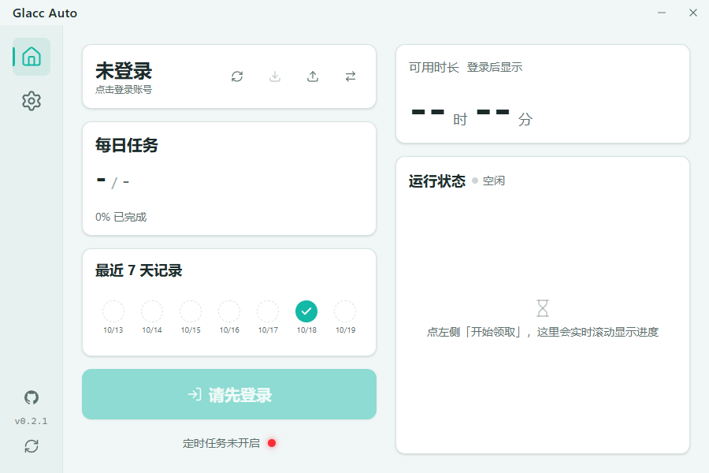

<div align="center">

# Glacc Auto

一款现代、极简的 Windows 桌面自动化辅助工具。

 

</div>



## 简介

Glacc Auto 是一款专为 Windows 平台设计的桌面自动化任务工具。基于 Tauri v2、Rust 与 Svelte 5 构建，不捆绑多余的浏览器内核，提供原生轻量、流畅且纯净的桌面端体验。通过底层的严格串行控制，在保证安全的前提下简化日常的重复性操作。

## 核心特性

- **原生轻量**：基于 Tauri v2，内存占用极低，启动迅速。
- **安全防封**：严格遵循单线程串行逻辑，拒绝并发与代理池，模拟真人操作节奏。
- **现代界面**：现代化仪表盘 UI，支持深浅色模式跟随系统，交互丝滑。
- **自动化调度**：支持 Windows 系统级计划任务，实现每日定时静默运行。
- **多账号管理**：本机安全保存，支持最多 3 个账号快速切换，无云端同步。
- **状态追踪**：内置每日任务进度预览与近 7 天历史记录。

## 快速开始

请前往 [Releases](https://github.com/miaocell/glacc-auto/releases) 页面下载最新的安装包。

## 本地开发

请确保已安装 Node.js、Rust 以及 Windows SDK 构建环境。

```bash
# 安装前端依赖
npm install

# 开发模式运行
npm run tauri dev

# 构建生产版本
npm run tauri build
```

## 开源协议与致谢
本项目基于[原作者 JiangXu26710](https://github.com/JiangXu26710) 的早期版本进行彻底重构。

本项目遵循原作者的 PolyForm Noncommercial 1.0.0 协议。

严禁任何商业或盈利性使用，严禁在任何第三方电商平台倒卖。

## 免责声明
本项目仅供个人学习、研究与技术交流，严禁任何商业或盈利性使用。本软件为非官方第三方工具，与任何第三方服务提供方无任何关联。使用可能带来的账号限制、权益损失及法律风险由使用者自行承担。

<div align="center"> <i>Glacc Auto - 专注于高效与纯粹</i> </div>
